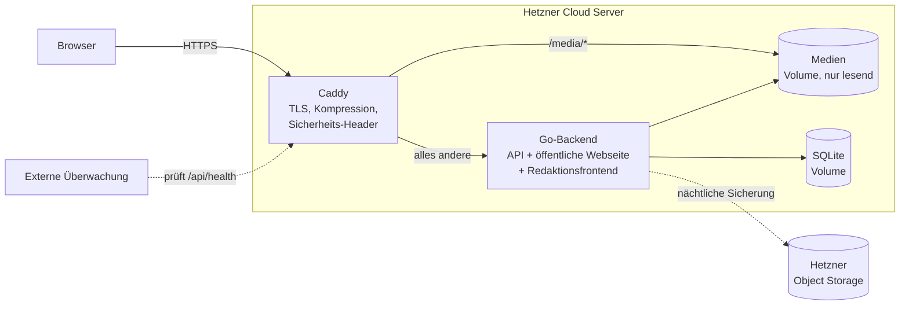
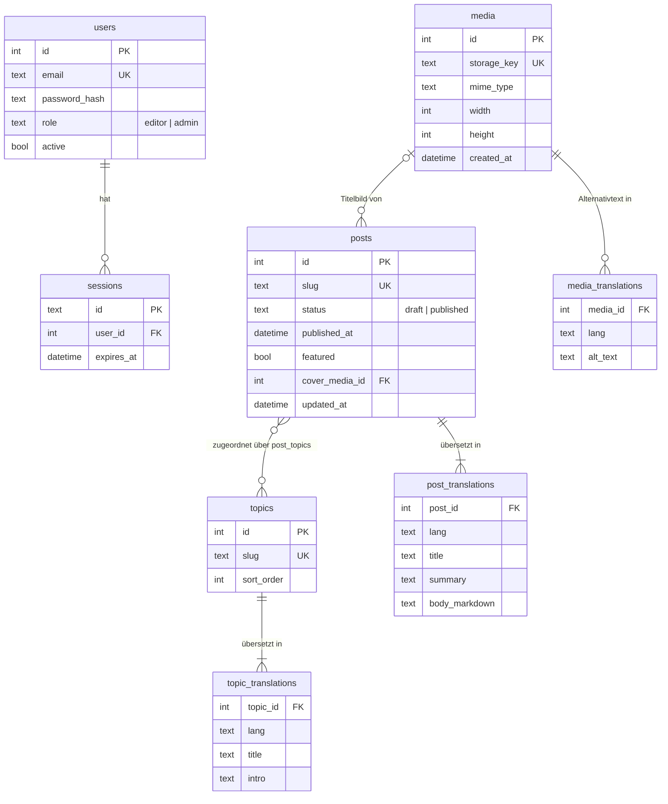

# Architektur

> **Stand:** 2026-11-06 · **Grundlage:** Anforderungen 1 bis 7 und 11 in diesem Ordner sowie das [Design-Konzept](../Design.md)

Dieses Dokument beschreibt die technische Architektur der KI-Webseite. Es legt Technologien, Aufbau, Datenmodell, Schnittstellen und Betrieb fest. Die Gründe für wichtige Entscheidungen stehen in den Architekturentscheidungen (siehe Abschnitt 12).

---

## 1 Überblick

| Bereich | Technologie |
|---|---|
| Versionsverwaltung | Git, ein gemeinsames Repository für Frontend, Backend und Betrieb |
| Frontends | Öffentliche Webseite und separates Redaktionsfrontend, jeweils mit React, TypeScript und Vite |
| Backend | Go mit JSON-API über HTTP. Liefert beide Frontends aus. |
| Schnittstelle | OpenAPI-Beschreibung als verbindlicher Vertrag zwischen Frontend und Backend |
| Datenbank | SQLite (zunächst), später bei Bedarf PostgreSQL |
| Betrieb | Docker Compose auf einem Hetzner-Cloud-Server |



**Grundprinzipien**

- **Einfach starten.** Ein Server, zwei Container, eine Datei als Datenbank. Mehr Komponenten kommen erst, wenn sie gebraucht werden.
- **Sicherheit im Backend.** Ob ein Beitrag öffentlich ist und ob jemand die Redaktion nutzen darf, entscheidet ausschließlich das Backend (Anforderungen 4, 5 und 6).
- **Jede Ansicht hat eine echte URL.** Die Zurück-Taste des Browsers funktioniert immer (Design-Konzept, Prinzip *Agency*). Jede öffentliche URL liefert bereits beim ersten Aufruf passende Titel und Vorschau-Informationen.
- **Keine Daten an Dritte.** Die Seite lädt keine externen Schriften, Skripte oder Tracker.

---

## 2 Git-Repository

### Struktur

```
/
├── api/
│   └── openapi.yaml     Verbindliche Beschreibung der Schnittstelle
├── frontend/            Öffentliche Webseite (React, TypeScript, Vite)
│   ├── src/
│   │   └── api/         Aus openapi.yaml erzeugte Typen (nicht von Hand ändern)
│   └── package.json
├── frontend-redaktion/  Redaktionsfrontend mit eigenem Vite-Build
├── backend/             Go-Modul
│   ├── cmd/server/      Einstiegspunkt (main.go)
│   ├── internal/        API, Fachlogik, Datenzugriff, Auth, Medien, Seitenauslieferung
│   ├── migrations/      SQL-Migrationen
│   └── go.mod
├── deploy/
│   ├── Caddyfile
│   └── backup/          Sicherungsskript
├── docs/
│   └── adr/             Architekturentscheidungen
├── requirements/        Anforderungen und Architektur
├── Dockerfile           Baut beide Frontends und das Backend zu einem Image
├── compose.yaml         Produktion
├── compose.dev.yaml     Ergänzungen für die lokale Entwicklung
├── renovate.json        Automatische Aktualisierung von Abhängigkeiten
├── .env.example         Vorlage für Umgebungsvariablen (ohne Geheimnisse)
└── README.md
```

### Arbeitsweise

- **Hauptzweig `main`** ist immer auslieferbar und geschützt. Änderungen kommen nur über Pull Requests mit erfolgreicher CI.
- **Feature-Zweige** pro Anforderung, z. B. `feature/5-redaktionssystem`.
- **Commit-Nachrichten** folgen [Conventional Commits](https://www.conventionalcommits.org/de/v1.0.0/) (`feat:`, `fix:`, `docs:` …).
- **Releases** werden mit Git-Tags markiert (`v1.0.0`). Ein Tag löst den Bau des Docker-Images aus.
- **Nicht ins Repository** gehören Datenbankdateien (`*.db`), hochgeladene Medien, `.env`-Dateien, Zugangsdaten und Build-Artefakte. Die `.gitignore` schließt sie aus. Erzeugter Code aus `openapi.yaml` wird dagegen eingecheckt, damit Änderungen im Pull Request sichtbar sind.

---

## 3 Frontends

Die öffentliche Webseite und das Redaktionsfrontend sind eigenständige React-Anwendungen mit eigenen Einstiegspunkten und Builds. Beide laufen unter derselben Domain und verwenden dieselbe Go-API. Das Redaktionsfrontend hat ein eigenes Layout und verwendet `/redaktion` als Basispfad. Die Sprachpräfixe der öffentlichen Webseite gelten für die öffentlichen Routen.

| Aspekt | Entscheidung |
|---|---|
| Sprache | TypeScript im `strict`-Modus |
| Build | Vite, Ergebnis sind statische Dateien. Das Backend bettet sie beim Bau ein. |
| Routing | React Router, jede Ansicht hat eine eigene URL |
| Datenabruf | Typisierter Client mit [openapi-fetch](https://openapi-ts.dev/openapi-fetch/), TanStack Query für Caching und Ladezustände |
| Mehrsprachigkeit | Sprache als URL-Präfix (`/de/…`, `/en/…`), Oberflächentexte mit i18next |
| Gestaltung | CSS mit Design-Tokens als CSS-Variablen gemäß [Design-Konzept](../Design.md) |
| Schriften | Selbst gehostete WOFF2-Dateien im Repository, kein Google Fonts und kein CDN |
| Beitragsinhalt | Markdown, dargestellt mit `react-markdown` ohne rohes HTML |
| Bilder | `` mit `srcset` und `sizes`, `loading="lazy"` außerhalb des sichtbaren Bereichs |
| Tests | Vitest und Testing Library für Komponenten, Playwright für Abnahmetests |

### Routen

| URL | Ansicht | Anforderung |
|---|---|---|
| `/:lang` | Startseite mit Beitrags-Karussell und Themenkarten | 1 |
| `/:lang/themen/:slug` | Themenseite | 3 |
| `/:lang/blog` | Blogübersicht | 4 |
| `/:lang/blog/:slug` | Beitragsseite | 4 |
| `/:lang/impressum` | Impressum | – |
| `/:lang/datenschutz` | Datenschutzerklärung | – |
| `/redaktion/anmelden` | Anmeldung im Redaktionsfrontend | 6 |
| `/redaktion` | Beitragsliste der Redaktion | 5, 6 |
| `/redaktion/beitraege/:id` | Beitrag bearbeiten | 5 |
| `/redaktion/medien` | Medienverwaltung | 5 |
| `/redaktion/benutzer` | Benutzerverwaltung für Admin-Konten | 11 |

- Die Kopfzeile mit Themenmenü, Bloglink, Sprachwahl und Kontoeinstieg ist eine gemeinsame Layout-Komponente aller öffentlichen Seiten (Anforderungen 2 und 7). Die Fußzeile verlinkt Impressum und Datenschutz.
- Impressum und Datenschutzerklärung liegen als Markdown-Dateien je Sprache im Repository. Änderungen laufen über einen Pull Request.
- Beim Sprachwechsel tauscht das Frontend nur das Präfix der URL. Fehlt eine Übersetzung, liefert das Backend die vorhandene Fassung mit ihrer Sprache, und das Frontend zeigt einen Hinweis (Anforderung 7).
- Beim Seitenwechsel innerhalb der App setzt das Frontend Titel und Beschreibung im `<head>` selbst. Beim ersten Aufruf liefert sie bereits das Backend (siehe Abschnitt 6).
- Der öffentliche Kontoeinstieg verlinkt auf `/redaktion/anmelden`. Das Backend leitet nicht angemeldete Zugriffe auf geschützte Redaktionsseiten dorthin um und prüft die Rolle bei geschützten Seiten und API-Aufrufen.
- Nach der Anmeldung öffnet das Redaktionsfrontend für `editor` die Beitragsliste und für `admin` die Benutzerverwaltung.

---

## 4 Backend

| Aspekt | Entscheidung |
|---|---|
| Sprache | Go (aktuelle stabile Version) |
| HTTP | Standardbibliothek `net/http` mit dem Routing ab Go 1.22 |
| API-Code | Aus `openapi.yaml` erzeugt mit [oapi-codegen](https://github.com/oapi-codegen/oapi-codegen) (Server-Interface für `net/http`) |
| Datenbanktreiber | `modernc.org/sqlite` (reines Go, kein CGO, dadurch kleines statisches Image) |
| Datenzugriff | SQL-Abfragen mit [sqlc](https://sqlc.dev/) in typsicheren Go-Code übersetzt |
| Migrationen | [goose](https://github.com/pressly/goose), SQL-Dateien im Binary eingebettet, Ausführung beim Start |
| Bildverarbeitung | Standardbibliothek `image` und `golang.org/x/image` (reines Go) |
| Konfiguration | Umgebungsvariablen (z. B. `DATABASE_PATH`, `MEDIA_PATH`, `PUBLIC_BASE_URL`, `SESSION_SECRET`) |
| Logging | `log/slog` im JSON-Format |
| Tests | `go test` mit einer temporären SQLite-Datenbank je Test |

### Schichten

```
internal/
├── http/        Handler, Routing, Middleware (Auth, CSRF, Logging)
├── api/         Aus openapi.yaml erzeugter Code (nicht von Hand ändern)
├── web/         Auslieferung beider Frontends, Meta-Tags, Sitemap, robots.txt
├── service/     Fachlogik: Veröffentlichen, Zurücknehmen, Sprachauswahl
├── media/       Prüfen, Skalieren und Speichern von Bildern
├── store/       Datenzugriff (von sqlc erzeugt) hinter einem Interface
└── auth/        Passwort-Hashing, Sitzungen
```

Der Datenzugriff liegt hinter einem Interface. So lässt sich SQLite später gegen PostgreSQL tauschen, ohne Handler und Fachlogik zu ändern.

### Befehle des Binarys

| Befehl | Zweck |
|---|---|
| `server` | Startet die Anwendung (Standard) |
| `server user create --role admin` | Richtet das erste Admin-Konto bei der Inbetriebnahme ein. Redaktionskonten werden anschließend über das Redaktionsfrontend verwaltet. |
| `server healthcheck` | Ruft `/api/health` auf. Wird vom Docker-Healthcheck genutzt, weil das Image kein `curl` enthält. |
| `server backup` | Schreibt mit `VACUUM INTO` eine konsistente Kopie der Datenbank |

### Sicherheit

- **Passwörter** werden mit Argon2id gehasht.
- **Sitzungen** liegen in der Datenbank. Das Cookie ist `HttpOnly`, `Secure` und `SameSite=Lax`. Beim Abmelden wird die Sitzung gelöscht (Anforderung 6). Abgelaufene Sitzungen löscht ein täglicher Aufräumjob.
- **CSRF-Schutz** für alle schreibenden Anfragen über ein Token im Header.
- **Anmeldeversuche** werden pro IP-Adresse begrenzt. Die Zähler liegen nur im Arbeitsspeicher.
- **Rollen** trennt das Backend in `editor` für Beiträge und Medien sowie `admin` für die Benutzerverwaltung. Deaktivierte Konten können sich nicht anmelden. Beim Deaktivieren löscht das Backend alle Sitzungen des Kontos in derselben Transaktion und prüft bei geschützten Aufrufen den aktuellen Kontostatus.
- **Sicherheits-Header** setzt Caddy (siehe Abschnitt 9).

---

## 5 Schnittstelle (OpenAPI)

Die Datei `api/openapi.yaml` ist die einzige verbindliche Beschreibung der API. Änderungen an der Schnittstelle beginnen immer dort.

- **Frontend:** [openapi-typescript](https://openapi-ts.dev/) erzeugt daraus die TypeScript-Typen, openapi-fetch nutzt sie für typsichere Aufrufe.
- **Backend:** oapi-codegen erzeugt daraus die Go-Typen und ein Interface, das die Handler umsetzen müssen.
- **CI:** Die CI erzeugt den Code neu und bricht ab, wenn er vom eingecheckten Stand abweicht. Passen Frontend und Backend nicht zusammen, schlägt der Build fehl.

Die folgenden Tabellen geben einen Überblick. Alle Endpunkte liegen unter `/api` und sprechen JSON.

**Öffentlich (ohne Anmeldung)** – liefert ausschließlich veröffentlichte Beiträge.

| Methode | Pfad | Zweck |
|---|---|---|
| GET | `/api/topics?lang=de` | Alle Themen mit Titel und Einführung |
| GET | `/api/topics/{slug}?lang=de` | Ein Thema mit seinen veröffentlichten Beiträgen |
| GET | `/api/posts?lang=de&featured=true` | Veröffentlichte Beiträge, neueste zuerst |
| GET | `/api/posts/{slug}?lang=de` | Ein veröffentlichter Beitrag, sonst `404` |
| GET | `/api/health` | Zustand der Anwendung und der Datenbank |

**Anmeldung**

| Methode | Pfad | Zweck |
|---|---|---|
| POST | `/api/auth/login` | Anmelden, setzt Sitzungs-Cookie |
| POST | `/api/auth/logout` | Abmelden, löscht die Sitzung serverseitig |
| GET | `/api/auth/me` | Aktuelle Person und Rolle |

Die API bietet keinen Endpunkt zur Selbstregistrierung.

**Redaktion (nur mit Rolle `editor`)**

| Methode | Pfad | Zweck |
|---|---|---|
| GET | `/api/admin/posts` | Alle Beiträge inklusive Entwürfe |
| POST | `/api/admin/posts` | Neuen Entwurf anlegen |
| GET | `/api/admin/posts/{id}` | Beitrag zum Bearbeiten laden |
| PUT | `/api/admin/posts/{id}` | Texte, Übersetzungen, Titelbild und Themen speichern |
| POST | `/api/admin/posts/{id}/publish` | Veröffentlichen |
| POST | `/api/admin/posts/{id}/unpublish` | Veröffentlichung zurücknehmen |
| GET | `/api/admin/media` | Hochgeladene Bilder auflisten |
| POST | `/api/admin/media` | Bild hochladen (`multipart/form-data`) |
| PUT | `/api/admin/media/{id}` | Alternativtexte je Sprache ändern |

Ein Beitrag lässt sich nur veröffentlichen, wenn Titel, Kurztext und Beitragstext gefüllt sind (Anforderung 5). Hat er ein Titelbild, braucht es einen Alternativtext in der Sprache des Beitrags. Für Entwürfe liefern die öffentlichen Endpunkte `404`, damit ihre Existenz nicht erkennbar ist (Anforderung 4).

**Benutzerverwaltung (nur mit Rolle `admin`)**

| Methode | Pfad | Zweck |
|---|---|---|
| GET | `/api/admin/users` | Redaktionskonten mit E-Mail-Adresse und Status auflisten |
| POST | `/api/admin/users` | Redaktionskonto mit Rolle `editor` und Startpasswort anlegen |
| PATCH | `/api/admin/users/{id}` | Ein Redaktionskonto deaktivieren oder reaktivieren |

Die API gibt keine Passwörter oder Passwort-Hashes zurück. Geschützte API-Aufrufe ohne gültige Sitzung liefern `401`, Aufrufe mit unzureichender Rolle liefern `403`.

---

## 6 Seitenauslieferung, Suchmaschinen und Link-Vorschauen

Das Go-Backend liefert beide Frontends aus. Für die öffentliche Webseite ergänzt es Meta-Tags für Suchmaschinen und Link-Vorschauen.

### Ablauf

1. Beide Frontend-Builds werden getrennt mit `go:embed` in das Backend-Binary eingebettet.
2. Dateien unter `/assets/*` und `/redaktion/assets/*` liefert das Backend mit `Cache-Control: public, max-age=31536000, immutable` aus. Vite versieht sie mit einem Hash im Dateinamen.
3. Für öffentliche Seitenaufrufe rendert das Backend die öffentliche `index.html` als Go-Template (`html/template`) und setzt passend zur URL:
   - `<title>` und `<meta name="description">`
   - Open-Graph- und Twitter-Card-Tags (`og:title`, `og:description`, `og:image`, `og:url`, `og:locale`)
   - `<link rel="canonical">`
   - `<link rel="alternate" hreflang="…">` für jede vorhandene Übersetzung sowie `x-default` (Deutsch)
   - `<html lang="…">`
4. Die öffentliche `index.html` erhält `Cache-Control: no-cache`.
5. Für bekannte Redaktionsrouten liefert das Backend die separate `index.html` des Redaktionsfrontends nach der jeweiligen Zugriffskontrolle aus. Die Anmeldeseite ist öffentlich erreichbar. Redaktionsseiten erhalten `Cache-Control: no-store`.

### Statuscodes

- Existiert ein Thema oder ein veröffentlichter Beitrag nicht, antwortet das Backend mit HTTP `404`. Die React-App zeigt dann die Fehlerseite. Das gilt auch für Entwürfe (Anforderung 4).
- Unbekannte Pfade liefern ebenfalls `404`.

### Sitemap und robots.txt

- `/sitemap.xml` erzeugt das Backend aus der Datenbank. Sie enthält Start-, Themen-, Blog- und Beitragsseiten je Sprache mit `lastmod` und `hreflang`-Verweisen.
- `/robots.txt` sperrt `/redaktion` und `/api` und verweist auf die Sitemap.
- Seiten unter `/redaktion` tragen zusätzlich `X-Robots-Tag: noindex`.

---

## 7 Bilder und Medien

### Hochladen

- Erlaubt sind JPEG, PNG und WebP bis 10 MB. Das Backend prüft den Typ anhand des Dateiinhalts, nicht anhand der Endung.
- Vor dem Dekodieren liest es nur die Bildmaße (`image.DecodeConfig`) und lehnt Bilder über 40 Megapixel ab. Das schützt vor Dateien, die beim Entpacken den Speicher sprengen.
- Das Backend kodiert jedes Bild neu. Dabei entfallen Metadaten wie EXIF und GPS-Position.

### Varianten

| Variante | Größe | Verwendung |
|---|---|---|
| `480`, `960`, `1600` | Breite in Pixel, Seitenverhältnis bleibt | `srcset` in Karussell, Listen und Beiträgen |
| `og` | 1200 × 630, mittig zugeschnitten | Link-Vorschau (`og:image`) |

Fotos werden als JPEG gespeichert, Grafiken mit Transparenz als PNG.

### Ablage und Auslieferung

- Die Dateien liegen im Volume `app_media` unter einem zufälligen Schlüssel, z. B. `/media/3f9c…-960.jpg`.
- Weil sich eine Datei unter einem Schlüssel nie ändert, liefert Caddy sie mit `immutable` und einem Jahr Cache-Dauer aus.
- Caddy bindet das Volume nur lesend ein. Schreiben darf allein das Backend.
- In Beitragstexten fügt die Redaktion Bilder über eine Auswahl aus der Medienverwaltung ein. Das Frontend ergänzt beim Darstellen `srcset` und Alternativtext.
- Jedes Bild braucht vor der Verwendung in einem veröffentlichten Beitrag einen Alternativtext in der Sprache des Beitrags (Barrierefreiheit).
- Nicht mehr verwendete Bilder werden zunächst nicht automatisch gelöscht. Ein Aufräumjob kann später folgen.

---

## 8 Datenbank

### Warum zunächst SQLite

- Keine eigene Datenbank-Instanz nötig, die Daten liegen in einer Datei im Docker-Volume.
- Für einen Blog mit wenigen schreibenden Personen und vielen Lesezugriffen völlig ausreichend.
- Einfache Sicherung mit `VACUUM INTO`.

**Einstellungen:** `journal_mode=WAL` für gleichzeitiges Lesen während des Schreibens, `foreign_keys=ON` und `busy_timeout=5000`.

### Datenmodell



- Die drei Startthemen legt eine Migration als Startdaten an (Anforderung 3).
- Eine Migration ergänzt den Kontostatus. Bestehende Konten bleiben aktiv.
- `status` und `published_at` steuern die Sichtbarkeit. Zurücknehmen setzt `status` wieder auf `draft` (Anforderung 5).
- Übersetzungen sind eigene Zeilen je Sprache (`lang` = `de` oder `en`). Weitere Sprachen brauchen keine Schemaänderung (Anforderung 7).
- Die Bilddateien selbst liegen nicht in der Datenbank, sondern im Medien-Volume.

### Späterer Wechsel zu PostgreSQL

Ein Wechsel wird sinnvoll, wenn mehrere Backend-Instanzen nötig werden oder die Schreiblast deutlich steigt. Vorbereitet ist er durch Standard-SQL in den Abfragen, das Store-Interface und die Migrationen mit goose, das beide Datenbanken unterstützt. Die Auslöser hält die Architekturentscheidung zu SQLite fest.

---

## 9 Betrieb mit Docker Compose bei Hetzner

### Container

| Dienst | Image | Aufgabe |
|---|---|---|
| `caddy` | `caddy:2-alpine` (unverändert) | HTTPS mit automatischen Let's-Encrypt-Zertifikaten, Kompression, Sicherheits-Header, Auslieferung von `/media/*`, Weiterleitung aller anderen Anfragen an das Backend |
| `backend` | Eigenes Image `ki-web` | API, beide Frontends, Meta-Tags der öffentlichen Webseite, Sitemap, Bildverarbeitung, Migrationen beim Start |

Node baut beide Frontends getrennt. Go bettet die Build-Ergebnisse ein und baut ein statisches Binary für das Laufzeit-Image `gcr.io/distroless/static`. Beide Frontends und das Backend werden gemeinsam in einem Image pro Version ausgeliefert.

### compose.yaml (Skizze)

```yaml
x-logging: &logging
  driver: json-file
  options: { max-size: "10m", max-file: "5" }

services:
  caddy:
    image: caddy:2-alpine
    ports: ["80:80", "443:443"]
    environment:
      DOMAIN: ${DOMAIN}
    volumes:
      - ./deploy/Caddyfile:/etc/caddy/Caddyfile:ro
      - caddy_data:/data
      - app_media:/srv/media:ro
    depends_on:
      backend: { condition: service_healthy }
    restart: unless-stopped
    logging: *logging

  backend:
    image: ${REGISTRY}/ki-web:${VERSION}
    environment:
      DATABASE_PATH: /data/db/app.db
      MEDIA_PATH: /data/media
      PUBLIC_BASE_URL: https://${DOMAIN}
      SESSION_SECRET: ${SESSION_SECRET}
    volumes:
      - app_db:/data/db
      - app_media:/data/media
    healthcheck:
      test: ["CMD", "/server", "healthcheck"]
      interval: 30s
      timeout: 5s
      retries: 3
    restart: unless-stopped
    logging: *logging

volumes:
  caddy_data:
  app_db:
  app_media:
```

Das Backend ist nur im internen Docker-Netz erreichbar. Nach außen öffnet nur Caddy die Ports 80 und 443.

### Caddyfile (Skizze)

```
{$DOMAIN} {
    encode zstd gzip

    header {
        Strict-Transport-Security "max-age=31536000; includeSubDomains"
        Content-Security-Policy "default-src 'self'; img-src 'self' data:; object-src 'none'; base-uri 'self'; form-action 'self'; frame-ancestors 'none'"
        Referrer-Policy "strict-origin-when-cross-origin"
        X-Content-Type-Options "nosniff"
        Permissions-Policy "camera=(), microphone=(), geolocation=()"
        -Server
    }

    handle_path /media/* {
        root * /srv/media
        header Cache-Control "public, max-age=31536000, immutable"
        file_server
    }

    handle {
        reverse_proxy backend:8080
    }

    log {
        output file /data/logs/access.log {
            roll_keep_for 168h
        }
        format filter {
            wrap json
            fields {
                request>remote_ip ip_mask {
                    ipv4 24
                    ipv6 48
                }
            }
        }
    }
}
```

Die Content-Security-Policy erlaubt nur Inhalte vom eigenen Server. Damit ist technisch ausgeschlossen, dass versehentlich externe Schriften oder Skripte geladen werden.

### Hetzner-Infrastruktur

| Baustein | Entscheidung |
|---|---|
| Server | Ein Hetzner-Cloud-Server mit 2 vCPU und 4 GB RAM reicht für den Start |
| Standort | Deutschland (Falkenstein oder Nürnberg), damit die Daten in der EU bleiben |
| Betriebssystem | Ubuntu LTS mit Docker Engine und Compose-Plugin |
| Firewall | Hetzner Cloud Firewall: eingehend nur 22 (SSH, nur per Schlüssel), 80 und 443 |
| DNS | A- und AAAA-Eintrag der Domain auf die Server-IP |
| Sicherung | Hetzner-Server-Backups plus tägliche Sicherung in Hetzner Object Storage |

### Datensicherung

Ein nächtlicher Cron-Job auf dem Server führt `deploy/backup/backup.sh` aus:

1. `docker compose exec backend /server backup` schreibt eine konsistente Kopie der Datenbank in das Volume.
2. [restic](https://restic.net/) sichert diese Kopie und das Medien-Volume verschlüsselt und inkrementell in einen Bucket in Hetzner Object Storage.
3. `restic forget --keep-daily 30 --prune` behält 30 tägliche Stände.
4. Bei Erfolg meldet das Skript sich bei der Überwachung (siehe Abschnitt 10). Bleibt die Meldung aus, gibt es eine Benachrichtigung.

Eine Wiederherstellung wird mindestens einmal pro Quartal auf einem frischen Server getestet. Optional später: [Litestream](https://litestream.io/) für kontinuierliche Replikation der Datenbank.

### Auslieferung (CI/CD)

1. Bei jedem Pull Request laufen Linting, Typprüfung, Prüfung des erzeugten API-Codes und Unit-Tests für beide Frontends und das Backend.
2. Bei einem Git-Tag: Docker-Image bauen und mit der Versionsnummer in eine Container-Registry schieben.
3. Deployment per SSH auf den Server: `VERSION` in `.env` setzen, dann `docker compose pull && docker compose up -d`.
4. Rollback: vorherige `VERSION` eintragen und Schritt 3 wiederholen. Migrationen sind daher nur additiv.

---

## 10 Überwachung und Wartung

### Überwachung

| Was | Wie |
|---|---|
| Anwendung läuft | `/api/health` prüft mit `SELECT 1` die Datenbank und antwortet mit `200` oder `503`. Docker startet den Container bei wiederholtem Fehler neu. |
| Seite ist von außen erreichbar | Ein externer Dienst ruft jede Minute `https://<domain>/api/health` auf und benachrichtigt bei Ausfall. Er läuft bewusst nicht auf demselben Server. |
| Zertifikat ist gültig | Derselbe Dienst warnt 14 Tage vor Ablauf des TLS-Zertifikats. |
| Sicherung ist gelaufen | Das Sicherungsskript meldet sich nach Erfolg bei einem Heartbeat-Endpunkt. Fehlt die Meldung 26 Stunden lang, folgt eine Benachrichtigung. |

### Logs

- Docker begrenzt die Container-Logs auf 5 Dateien zu je 10 MB.
- Caddy kürzt IP-Adressen im Zugriffslog und löscht Logdateien nach 7 Tagen.
- Das Backend protokolliert keine IP-Adressen und keine Inhalte von Anfragen.

### Wartung

- **Betriebssystem:** `unattended-upgrades` installiert Sicherheitsupdates automatisch. Ist ein Neustart nötig, erfolgt er nachts um 4 Uhr. Die Container starten danach von selbst.
- **Abhängigkeiten:** [Renovate](https://docs.renovatebot.com/) öffnet Pull Requests für neue Versionen von npm-Paketen, Go-Modulen, Basis-Images im `Dockerfile` und dem Caddy-Image in `compose.yaml`. Images sind per Digest festgelegt. Updates laufen wie jede Änderung durch die CI und werden von Hand gemergt.
- **Go und Node:** Die Versionen im `Dockerfile` werden mit Renovate aktuell gehalten.

---

## 11 Datenschutz

| Thema | Umsetzung |
|---|---|
| Impressum und Datenschutzerklärung | Eigene Seiten je Sprache, aus jeder Seite über die Fußzeile erreichbar |
| Auftragsverarbeitung | Auftragsverarbeitungsvertrag mit Hetzner für Server und Object Storage abschließen (in der Hetzner-Konsole verfügbar). Ebenso mit dem externen Überwachungsdienst, falls er personenbezogene Daten verarbeitet. |
| Keine Daten an Dritte | Schriften selbst gehostet, keine CDNs, keine eingebetteten Inhalte fremder Anbieter. Die Content-Security-Policy erzwingt das. |
| Cookies | Nur das Sitzungs-Cookie der Redaktion. Es ist technisch notwendig, für Besucherinnen und Besucher gibt es keine Cookies und kein Einwilligungsbanner. |
| Reichweitenmessung | Zunächst keine. Falls gewünscht, nur ein cookieloses Werkzeug auf dem eigenen Server (z. B. [Umami](https://umami.is/)). Das wird vorher als Architekturentscheidung festgehalten. |
| IP-Adressen | Im Zugriffslog gekürzt, nach 7 Tagen gelöscht. Die Begrenzung der Anmeldeversuche hält IP-Adressen nur im Arbeitsspeicher. |
| Bilder | Metadaten wie GPS-Position werden beim Hochladen entfernt. |
| Konten der Redaktion | Gespeichert werden E-Mail-Adresse, Passwort-Hash, Rolle und Kontostatus. Abgelaufene Sitzungen werden täglich gelöscht. |
| Sicherungen | Verschlüsselt mit restic, Aufbewahrung 30 Tage, Speicherort in Deutschland |

---

## 12 Architekturentscheidungen (ADR)

Wichtige Entscheidungen werden als kurze Architecture Decision Records im Ordner `docs/adr` festgehalten. Dieses Dokument beschreibt den aktuellen Stand, die ADRs erklären, warum er so ist.

### Wann ein ADR nötig ist

- Die Entscheidung ist schwer rückgängig zu machen, z. B. Datenbank, Hosting oder Anmeldeverfahren.
- Sie betrifft mehrere Teile der Anwendung.
- Es gab ernsthafte Alternativen, und spätere Teammitglieder würden fragen, warum es nicht anders gemacht wurde.

### Form

- Dateiname: fortlaufende Nummer und Titel, z. B. `0003-sqlite-als-erste-datenbank.md`.
- Inhalt nach dem Muster von [Michael Nygard](https://cognitect.com/blog/2011/11/15/documenting-architecture-decisions): **Status** (vorgeschlagen, angenommen, ersetzt durch …), **Kontext**, **Entscheidung**, **Konsequenzen**.
- Ein angenommenes ADR wird nicht mehr geändert. Ändert sich die Entscheidung, ersetzt ein neues ADR das alte und verweist darauf.
- ADRs entstehen im selben Pull Request wie die Änderung, die sie begründen.

### Erste ADRs

| Nr. | Entscheidung |
|---|---|
| 0001 | Architekturentscheidungen als ADRs festhalten |
| 0002 | Ein gemeinsames Repository für Frontend, Backend und Betrieb |
| 0003 | SQLite als erste Datenbank, mit Kriterien für den Wechsel zu PostgreSQL |
| 0004 | Go-Backend liefert die React-App aus und setzt Meta-Tags (statt reiner Single-Page-App oder Server-Side-Rendering mit Node) |
| 0005 | Sitzungs-Cookies statt JWT für die Redaktion |
| 0006 | OpenAPI als verbindlicher Schnittstellenvertrag |
| 0007 | Hosting mit Docker Compose auf einem Hetzner-Cloud-Server |
| 0008 | Medien im Docker-Volume statt in Object Storage |

---

## 13 Lokale Entwicklung

- `docker compose -f compose.yaml -f compose.dev.yaml up` startet die gesamte Anwendung lokal ohne TLS.
- Alternativ für schnelle Iteration: `npm run dev` im Ordner `frontend` (Vite leitet `/api` und `/media` per Proxy weiter) und `go run ./cmd/server` im Ordner `backend`. Meta-Tags setzt in diesem Modus nur das Frontend.
- Das Redaktionsfrontend startet lokal mit `npm run dev` im Ordner `frontend-redaktion`. Sein Vite-Proxy leitet `/api` und `/media` an dasselbe Backend weiter.
- `make generate` erzeugt nach einer Änderung an `api/openapi.yaml` den Code für Frontend und Backend neu.
- Eine Seed-Migration für die Entwicklung legt Testbeiträge, Testbilder und ein Testkonto für die Redaktion an.

---

## 14 Zuordnung zu den Anforderungen

| Anforderung | Frontend | Backend |
|---|---|---|
| 1 Startseite | Karussell mit Titelbildern, Themenkarten | `GET /api/posts?featured=true`, `GET /api/topics`, Bildvarianten |
| 2 Navigation | Gemeinsame Kopfzeile | `GET /api/topics` |
| 3 Themenseiten | Route `/:lang/themen/:slug` | `GET /api/topics/{slug}`, Startdaten per Migration, Meta-Tags |
| 4 Öffentlicher Blog | Routen `/:lang/blog` und `/:lang/blog/:slug` | Öffentliche Endpunkte filtern auf `published`, `404` für Entwürfe, Meta-Tags und Sitemap |
| 5 Redaktionssystem | Routen unter `/redaktion`, Medienverwaltung | `/api/admin/posts…`, `/api/admin/media…` |
| 6 Zugang zur Redaktion | Anmeldeseite, Schutz der Routen | Sitzungen, Rollenprüfung, Middleware |
| 7 Sprachwechsel | URL-Präfix, i18next, Hinweis bei fehlender Übersetzung | `lang`-Parameter, Rückfall auf vorhandene Sprache, `hreflang` |
| 11 Benutzerverwaltung der Redaktion | `/redaktion/benutzer` | Admin-Rollenprüfung, `/api/admin/users…`, Kontostatus und Sitzungsentzug |
